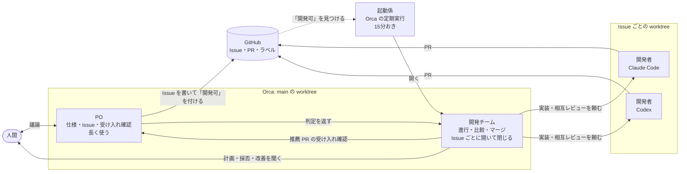
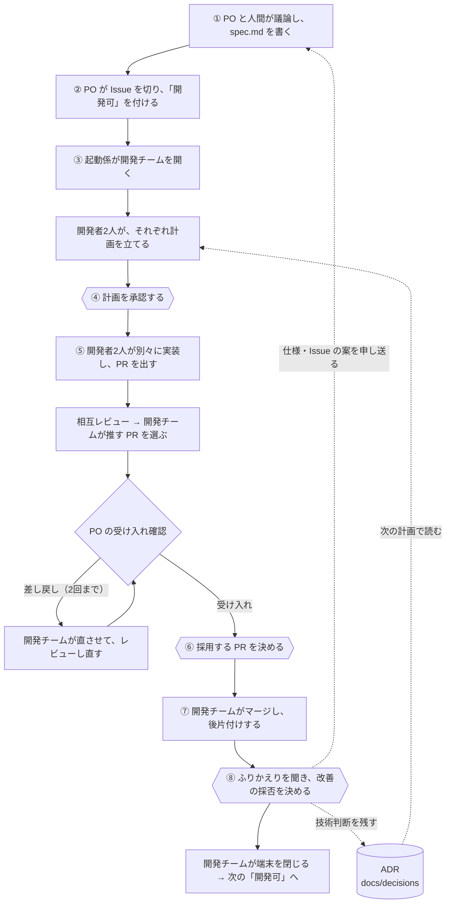

# エージェント開発テンプレート（Spec × Issue × Orca）

人間が判断し、AI エージェント（Claude Code と Codex）が仕様づくりから実装・レビュー・マージ・ふりかえりまでを進めるための、プロセス一式のテンプレートです。
エージェントは役割の違う3つの席に分かれ、[Orca](https://github.com/stablyai/orca)（複数の AI エージェントの端末と worktree をまとめて扱うアプリ）の上で動きます。

> **既定は Web アプリ（Node・Vite・React・Vitest）用です。** 何もしなければこの構成で動きます。
> 別の種類（スライド・文書など）にするときは、`CLAUDE.md` の「作るもの」と「開発設定」の表、`docs/testing.md` を書き換えます。→ [profiles/README.md](profiles/README.md)

## 仕組み

### 席と受け渡し

| 席 | 担当 |
|---|---|
| PO | 人間と議論して `spec.md` と Issue を書き、着手してよい Issue に「開発可」を付ける。開発チームが推す PR を、受け入れ条件・仕様・使う人の目で確かめる（コードは見ない） |
| 開発チーム | 1つの Issue を最後まで進める。開発者2人に同じ Issue を別々に実装させ、互いにレビューさせて、どちらを採るかを推す。マージ・後片付け・ふりかえりのあと、自分の端末を閉じる |
| 開発者 | 自分の worktree で計画・実装・PR・レビューを行う（Claude Code と Codex が1人ずつ） |
| 起動係 | 「開発可」の Issue があり、動いている開発チームがいないときだけ、開発チームを開く（同時に1つまで） |

PO と開発チームを分けているのは、1つの端末にまとめると文脈がすぐあふれ、開発中にプロダクトの検討を進めにくくなるためです。

### Issue 1本の流れ

六角形が人間の判断です。それ以外はエージェントが進めます。

人間がすることは、PO との議論と、④⑥⑧の3つの判断です。記録は GitHub（Issue・PR・コメント）と `docs/issue-reports/` に残ります。ふりかえりでは、作業ごとの開始・終了の表（`work-times.py`）を見て、時間のかかった作業や過剰な作業を改善します。

## 始め方

1. GitHub で「Use this template」から新しいリポジトリを作り、手元に clone する
2. `CLAUDE.md` の `<…>` を埋める。「作るもの」と「開発設定」の表を、作るものに合わせて直す（Web アプリなら、ほぼそのまま）。終わったら `AGENTS.md` に同じ内容をコピーする
3. Web アプリなら `profiles/web-app/ci.yml` を `.github/workflows/ci.yml` にコピーし、アプリの雛形と `.nvmrc`（Node の版）を作る
4. GitHub にラベルを作る: `gh label create 開発可` と `gh label create 着手中`。マージは squash を許可しておく
5. Orca でリポジトリを開き、PO の端末を開く（[workflow.md「PO を開く」](docs/workflow.md#po-を開く)）。`dev-team.sh po-register` で登録する
6. Orca の定期実行「開発チーム起動」を作る（[workflow.md「開発チームを開く」](docs/workflow.md#開発チームを開く起動係)）
7. PO と議論して `docs/spec.md` の初版を作り、最初の Issue を切って「開発可」を付ける

モデルの指定は `.claude/skills/dual-implement/SKILL.md` の「モデルの指定」と、[workflow.md](docs/workflow.md) のコーディネーターのモデルにあります。Codex の既定は `~/.codex/config.toml` で決まります。

## 中身

| 場所 | 中身 |
|---|---|
| [CLAUDE.md](CLAUDE.md) / [AGENTS.md](AGENTS.md) | エージェント向けガイド。「作るもの」と「開発設定」の表がプロジェクトごとの値 |
| `.claude/skills/` | 4つのスキル: `implement-issue`（1本実装）・`dual-implement`（開発チームの③〜⑥）・`accept-review`（PO の受け入れ確認）・`finish-issue`（⑦〜⑧）と補助スクリプト。`.agents/skills/` は Codex 用のシンボリックリンク |
| [docs/workflow.md](docs/workflow.md) | 開発の進め方（3つの席・8ステップ） |
| [docs/testing.md](docs/testing.md) | テスト（確かめ方）とレビューの方針。作るものの種類ごとに書き換える |
| [docs/spec.md](docs/spec.md) / [docs/next-issues.md](docs/next-issues.md) | 仕様と現在地の雛形（PO が書く） |
| [docs/decisions/](docs/decisions/README.md) | 技術判断の記録（ADR）の書き方と雛形 |
| [docs/issue-reports/](docs/issue-reports/README.md) | Issue ごとの記録の書き方 |
| [profiles/](profiles/README.md) | 作るものの種類ごとの設定 |
| [docs/origin.md](docs/origin.md) | 取り出し元のプロジェクトとコミット |

## 前提
- [Orca](https://github.com/stablyai/orca)、Claude Code、Codex CLI、GitHub CLI（`gh`）、Python 3、Bash
- `.agents/skills/` はシンボリックリンクとして GitHub に保存されている。Windows で clone した場合の扱いは確かめていない
- まだ確かめていないこと: 開発チームを Codex にした構成

## ライセンス
[MIT No Attribution（MIT-0）](LICENSE)。著作権表示を残す必要もなく、自由に使い・変え・配れます。テンプレートから作ったプロジェクトでは、この `LICENSE` を消しても、自分のライセンスに差し替えても構いません。
